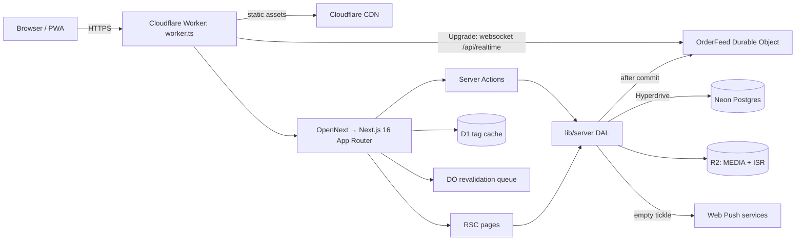

# 00 — فهم المشروع وخط الأساس

> تاريخ التدقيق: 2026-11-04 · الفرع: `hardening/elite-upgrade` · خط الأساس: `main@f2cb693`
> المصدر الحاكم: `docs/technical-spec.md` (و§18) + `AGENTS.md`.

## 1. الغرض والنطاق

JPasta تطبيق **متجر واحد** في قلقيلية: قائمة رقمية، طلب مباشر (استلام/توصيل)
وكونسول مالك (لوحة طلبات، مطبخ، أرشيف، تقارير، مخزون، موظفون، إعدادات، Web
Push). لا يوجد تعدد فروع، ولا بوابة دفع إلكتروني، ولا تطبيق أصلي — PWA cover.

## 2. المعمارية (Modular Monolith)

**حدود الثقة:**

| الحد                   | الضابط                                                           |
| ---------------------- | ---------------------------------------------------------------- |
| متصفح → Server Actions | zod، جلسة `__Host-` HttpOnly، فحص Origin الخاص بـ Next           |
| متصفح → `/api/*`       | جلسة/توكن capability، حدود المعدل، `no-store`                    |
| `/api/realtime` → DO   | توكن HMAC قصير العمر؛ بث داخلي بـ `REALTIME_SECRET` (ثابت الزمن) |
| Server → Postgres      | استعلامات Drizzle مُعاملة، CHECK constraints، معاملات            |
| Server → R2            | رفع owner-only، فحص magic bytes، مفاتيح مولّدة                   |
| Server → push services | allowlist لمضيفي المتصفح، HTTPS فقط، بث فارغ بلا PII             |
| CSV → Excel            | owner-only، الافتراضي بلا PII، quoting + تحييد حقن الصيغ         |
| Cloudflare → secrets   | Wrangler secrets؛ لا أسرار في `wrangler.jsonc` أو العميل         |

**أصناف البيانات:** أسعار/مخزون/طلبات (بيانات مالية)، اسم/هاتف/عنوان/ملاحظة
(PII مشفّرة في الإنتاج)، جلسات/PIN (اعتماد)، مفاتيح push (سرية تشغيلياً)،
سجل تدقيق الحالات (يبقى ولا يُقلَّم).

## 3. مسار الأموال (ملخص)

1. zod + `placeOrder(input, { source })`؛ العميل يرسل مفاتيح الخيارات فقط.
2. `payload_hash = sha256(stableStringify(input))`؛ إعادة المحاولة بالنتيجة الأصلية.
3. معاملة: قفل المخزون/العداد، إعادة تسعير كل سطر من DB، التحقق من منطقة
   التوصيل، رقم طلب يومي متسلسل، كتابة الطلب + السطور + سجل الحالة + خصم الوصفة.
4. بعد commit: `notifyOrdersChanged()` (DO) + Push فارغ.

## 4. خط الأساس المقاس (قبل التغييرات)

البيئة: Node 22.20.0، npm 10.9.3، Postgres 17 محلي على `127.0.0.1:54330`.
لم يُستخدم أي بيئة إنتاج أو بيانات حقيقية.

| القياس                                | النتيجة                                                             |
| ------------------------------------- | ------------------------------------------------------------------- |
| `format:check` / `lint` / `typecheck` | ناجحة                                                               |
| `check:contrast`                      | 10/10 أزواج ناجحة                                                   |
| `npm test`                            | **104** اختباراً في 22 ملفاً (20.62s)                               |
| `npm run build`                       | ناجح (17.14s)                                                       |
| `npm run build:cf`                    | ناجح (39.60s)                                                       |
| Playwright E2E                        | **49/49** (1.2m)                                                    |
| Lighthouse mobile `/`                 | perf 0.75 · LCP 4124ms · CLS 0 · TBT 447ms · JS 178KB · fonts 163KB |
| Lighthouse mobile `/menu`             | perf 0.78 · LCP 4154ms · CLS 0 · TBT 372ms · JS 224KB · fonts 163KB |
| Lighthouse desktop `/`                | perf 1.00 · LCP 798ms · CLS 0 · TBT 12.5ms                          |
| Lighthouse desktop `/menu`            | perf 0.99 · LCP 913ms · CLS 0 · TBT 11.5ms                          |
| `npm audit --omit=dev`                | **0** ثغرات                                                         |
| `npm audit` (كل الاعتماديات)          | 42 (2 low، 23 moderate، 17 high) — كلها في أدوات التطوير            |
| حجم `.next/static`                    | 1.5MB (كل المسارات مجتمعة)                                          |

## 5. افتراضات وحدود التحقق

- قاعدة البيانات المحلية قابلة للتدمير ومخصصة للاختبارات (يحرسها
  `test/db.ts` و`vitest.config.mts` ضد أي host غير loopback).
- لم يتم نشر المشروع فعلياً على Cloudflare/Neon؛ `wrangler.jsonc` ما زال يحوي
  `REPLACE_WITH_*`، ونتاج التحقق هو `wrangler deploy --dry-run`/`build:cf` فقط.
- لا توجد بيانات RUM ميدانية؛ أرقام Lighthouse مخبرية وقد تتغير بحمل الجهاز.
- لا توجد مراجعة ASVS طرف ثالث؛ خريطة `docs/SECURITY.md` تنفيذية.
- لم تُختبر استعادة نسخة إنتاجية فعلية؛ النسخ الاحتياطي محلي/CI فقط.
- ثغرات `npm audit` الكاملة تخص سلسلة أدوات التطوير
  (`@lhci/cli`/`chromium-bidi`/`uuid` وغيرها) وليست في حزمة الإنتاج.
